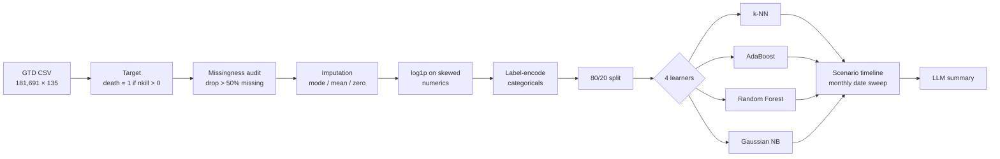
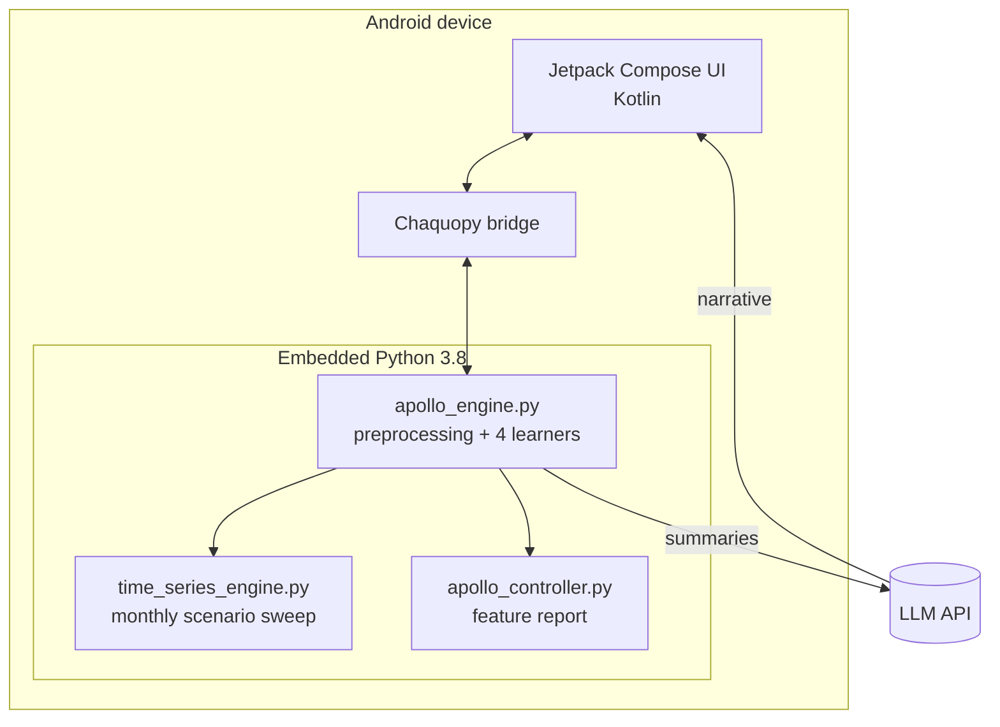
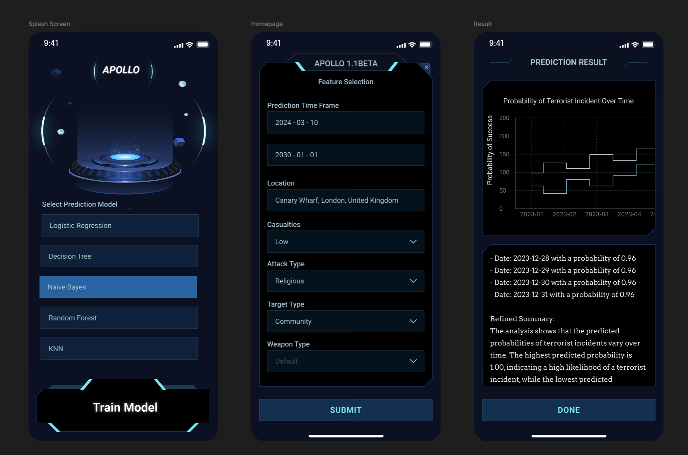

<div align="center">

# Apollo

**Estimating the lethality of terrorist incidents from open-source event data**

*An applied machine-learning study on the Global Terrorism Database, delivered as an on-device prediction app*

-3DDC84)


-lightgrey)


</div>

---

## Abstract

Apollo asks a narrow, measurable question: **given what is known about a violent incident (where, when, how, and against whom), what is the probability that it results in at least one death?** We use the Global Terrorism Database (GTD; 181,691 incidents, 135 variables, 1970–2017 release) and frame lethality as a binary target (`death = 1 if nkill > 0`). We characterise the dataset's missingness, rank candidate predictors, and compare four classical learners: k-Nearest Neighbours, AdaBoost, Random Forest and Gaussian Naïve Bayes. A *scenario timeline* holds an incident profile fixed and varies only its date at monthly resolution, to show how the model's estimate shifts over time. A large language model then turns the numbers into a plain-language summary for non-specialists. The full pipeline runs **on an Android device** through an embedded Python runtime.

This repository is **Apollo v1**, the original MSc Computer Science (Cyber Security) project at the University of Kent, 2024. A critical review of v1 and the leakage-safe rebuild that followed are summarised under [Limitations](#limitations-and-threats-to-validity) and [Roadmap](#roadmap-apollo-v2).

---

## Contents

1. [Motivation and related work](#1-motivation-and-related-work)
2. [Research questions](#2-research-questions)
3. [Data](#3-data)
4. [Methodology](#4-methodology)
5. [System architecture](#5-system-architecture)
6. [The application](#6-the-application)
7. [Results](#7-results)
8. [Limitations and threats to validity](#limitations-and-threats-to-validity)
9. [Ethical considerations](#ethical-considerations)
10. [Roadmap: Apollo v2](#roadmap-apollo-v2)
11. [Getting started](#getting-started)
12. [References](#references)

---

## 1. Motivation and related work

The GTD defines terrorism as *"the threatened or actual use of illegal force and violence by a non-state actor to attain a political, economic, religious, or social goal through fear, coercion, or intimidation."* It remains a persistent global threat, and machine learning on event databases has been proposed as a way to support counter-terrorism resource allocation.

Apollo began with a critical review of **He, Ando, Ye & Byun (2019), *Predicting Future Terrorist Attacks with State-of-the-Art Machine Learning Techniques*** (Harris School of Public Policy, University of Chicago). That work:

- framed prediction as **"will an attack occur at location *L* within two years?"**, with a bonus spatio-temporal RNN that used time- and distance-transition matrices;
- used the GTD plus geographic and socio-economic data, with a **temporal train/test split**;
- reported Random Forest as the strongest model, optimised for **Recall@10%**.

Our review found four weaknesses, and each one shaped Apollo's design:

| Finding in He et al. (2019) | Consequence | Apollo's response |
|---|---|---|
| Recall@10% ≈ **0.135** | Too weak for operational use in a high-stakes domain | Narrow the question from *occurrence* to *conditional lethality*, which the data supports better |
| Predictions varied by **religion and region** | Risk of discriminatory resource allocation | Incident-level outputs only; no person- or group-level scoring |
| GTD is **media-derived** | The model inherits reporting bias | Documented as a primary threat to validity |
| Deep-learning work not integrated; methods opaque to policymakers | Little practical uptake | An app front end and **LLM-generated plain-language explanations** |

---

## 2. Research questions

- **RQ1.** Which incident attributes are most strongly associated with fatal outcomes in the GTD?
- **RQ2.** How do standard classifiers compare at predicting whether an incident is fatal?
- **RQ3.** At what temporal resolution should model output be shown over time?
- **RQ4.** Can the whole pipeline (training, inference and explanation) run on a commodity mobile device?

---

## 3. Data

**Source.** [Global Terrorism Database](https://www.start.umd.edu/gtd/), from the National Consortium for the Study of Terrorism and Responses to Terrorism (START), University of Maryland. Accessed through the [Kaggle mirror](https://www.kaggle.com/datasets/START-UMD/gtd).

| Property | Value |
|---|---|
| Incidents (rows) | 181,691 |
| Variables (columns) | 135 |
| Temporal coverage | 1970–2017 |
| Spatial resolution | Country, region, province/state, city, latitude/longitude |
| Example fields | `iyear`, `country_txt`, `attacktype1`, `weaptype1`, `targtype1`, `nkill`, `nwound` |

**Selection criteria.** The dataset was chosen against explicit requirements: open and authoritative; human-readable column names; at least 1,500 rows; at least 2–3 continuous and 2–3 categorical variables; geographic fields for spatial analysis; and timestamps for temporal analysis.

> **Licence note.** The GTD is distributed for non-commercial research and may not be republished. Raw data is **not** included in this repository.

---

## 4. Methodology



### 4.1 Target definition

Rows with unknown `nkill` are removed. The rest are labelled **fatal** (`nkill > 0`) or **non-fatal** (`nkill = 0`). We chose a binary target over regressing the death count because `nkill` is heavily right-skewed and dominated by zeros.

### 4.2 Missing-data analysis

*(Internal report: "Report on Missing Values in the Dataset")*

We measured each column's percentage of missing values and plotted it against a **50% threshold**.

| Missingness | Examples | Treatment |
|---|---|---|
| **Very high (≈ 90%+)** | `weaptype4`, `weapsubtype4`, `gsubname3` | Dropped |
| **High (> 50%)** | `claimmode3`, `kidhijcountry` | Dropped; too noisy to impute reliably |
| **Moderate (10–50%)** | `related`, `alternative_txt`, `motive` | Imputed where kept; sensitivity check advised |
| **Low (< 10%)** | `nwound`, `nkillter`, `natlty1` | Simple imputation |

Imputation rules:

- Target nationality (`natlty1`) is filled from the incident's `country`.
- Categorical and coordinate fields (`latitude`, `longitude`, `weapsubtype1`, `targsubtype1`, `specificity`, `city`, `provstate`, …) take the **mode**.
- Count fields (`nperps`, `nperpcap`, `nwoundus`, `nkillus`, `nwoundte`) take the **mean**.
- `claimed` defaults to **0**.

Numeric features with skewness above 0.75 get a `log1p` transform. The `*_txt` duplicates of coded columns are dropped, and the remaining categoricals are label-encoded.

### 4.3 Feature analysis (RQ1)

*(Internal report: "Report on Important Features for Predicting Deaths in Terrorism Incidents")*

Pearson correlation of each feature with the `death` target:

| Rank | Feature | *r* | Reading |
|---:|---|---:|---|
| 1 | `weapsubtype1` | 0.330 | Weapon subtype; explosives and firearms dominate lethality |
| 2 | `success` | 0.308 | Whether the attack succeeded ⚠ |
| 3 | `nwound` | 0.240 | Number wounded ⚠ |
| 4 | `natlty1` | 0.231 | Nationality of the target |
| 5 | `INT_MISC` | 0.191 | Miscellaneous international involvement |
| 6 | `INT_LOG` | 0.180 | International logistical involvement |
| 7 | `INT_IDEO` | 0.178 | International ideological involvement |
| 8 | `country` | 0.175 | Country of the incident |
| 9 | `corp1` | 0.170 | Target's corporate or organisational entity |

> ⚠ **Retrospective note.** `success` and `nwound` are recorded *after* the event and partly reflect the same outcome as the target. They raise apparent accuracy but cannot be known beforehand. This is **target leakage**, and v2 removes it (see [Limitations](#limitations-and-threats-to-validity)). Pearson's *r* on label-encoded nominal codes is also a weak measure of association, so treat these rankings as exploratory.

During training, `SelectFromModel` (importance threshold 0.02) was run alongside each learner to inspect which features it relied on.

### 4.4 Models (RQ2)

Four classifiers from different families were trained on the same 80/20 split (`random_state = 43`):

| Model | Family | Why it was included |
|---|---|---|
| k-Nearest Neighbours | Instance-based | Non-parametric baseline |
| AdaBoost | Boosted ensemble | Strong on tabular data |
| **Random Forest** | Bagged ensemble | Best performer in prior work (He et al., 2019); interpretable importances |
| Gaussian Naïve Bayes | Probabilistic | Fast, simple probabilistic reference |

### 4.5 Temporal resolution (RQ3)

*(Internal report: "Time Interval for Generating the Time Series")*

Outputs over time are shown at **monthly** resolution:

| Interval | Verdict | Reason |
|---|---|---|
| Daily | ✗ | Sparse, zero-heavy series; noise drowns the signal |
| Weekly | ✗ | Too short to smooth noise; attacks don't follow a weekly cycle; overfitting risk |
| **Monthly** | ✓ | Balances granularity and density; captures seasonality and shifts in tactics |
| Quarterly / annual | ✗ | Hides meaningful change; too slow to help decision-makers |

The **scenario timeline** holds a user-specified incident profile fixed (location, attack type, weapon, target) and sweeps only the date across a range. Every learner scores each date, and the resulting curves are summarised by max, min, mean, standard deviation and trend.

### 4.6 Explanation layer

The time-series summaries from all four models, plus the location context, are sent to an LLM (OpenAI GPT-3.5). It returns a short, non-technical narrative of the trends. The LLM only *describes* the numbers; it never produces them.

---

## 5. System architecture



Preprocessing, training and inference all run locally on the phone. The only network call is to the LLM for the explanation text.

| Layer | Technology |
|---|---|
| UI | Kotlin, Jetpack Compose, Material 3 |
| Python runtime | Chaquopy (Python 3.8); min SDK 24, target SDK 34 |
| ML / data | scikit-learn, pandas, NumPy, SciPy, matplotlib |
| Explanation | OpenAI API (GPT-3.5) |
| Design | Figma; DALL·E for concept mock-ups |
| Research | Jupyter notebooks |

---

## 6. The application

<div align="center">
  
</div>

| Screen | Purpose |
|---|---|
| **Splash / training** | Starts on-device model training with a progress bar; lets the user delete the model and training data |
| **Feature input** | Date range, country, coordinates, attack type, target type, weapon type and casualty context |
| **Results** | Per-model probability timelines, model metrics (accuracy, F1) and the LLM narrative |

---

## 7. Results

In the v1 exploratory evaluation (random 80/20 split), Random Forest reached **about 86% accuracy**, the best of the four learners. This agrees with He et al. (2019).

**Read these numbers with caution.** A 2026 review found that the v1 evaluation overstates real-world performance (see below). We re-ran the task without leaked fields and tested on a held-out future period: 20,253 incidents from 2019 onward. A calibrated Random Forest then scores **ROC-AUC 0.84 and Brier score 0.169**, and beats prevalence and attack-type baselines on both ([Apollo v2 engine](https://github.com/idee24/apollo)). That figure is lower, but it is an honest estimate of what the model can do on future incidents.

---

## Limitations and threats to validity

Apollo v1 was a learning project, and recording its flaws is part of the scientific record.

1. **Target leakage.** Post-event fields (`nwound`, `success` and several casualty-derived columns) were used to predict a fatality outcome. They are not known at prediction time and they inflate accuracy.
2. **Random split on time-ordered data.** A shuffled 80/20 split lets the model learn from the future. Evaluation should hold out later years.
3. **Accuracy as the headline metric.** Accuracy depends on class balance and says nothing about whether a "70%" estimate is right 70% of the time. Calibrated probabilities, ROC/PR-AUC and Brier score are better suited.
4. **The scenario timeline is not a forecast.** Sweeping only the date shows how the model responds to time. It does **not** predict whether, where or how often an attack will happen.
5. **Media and reporting bias.** The GTD is compiled from open-source news, so coverage varies by region, language and period.
6. **Imputation before the split.** Global mode and mean values were computed on the full dataset before the train/test split. This leaks test-set statistics and may blur regional differences.
7. **Label encoding of nominal codes.** Treating country or weapon codes as numbers imposes an order that has no meaning.

---

## Ethical considerations

- **No individual scoring.** Apollo works at the incident level only. It never scores people, communities, religions or nationalities.
- **Decision support, not decision making.** Outputs are probabilistic and retrospective. They should inform analysis, not trigger action.
- **Fairness.** Geography and nationality are predictive features. v2 runs a subgroup calibration audit and a sensitive-feature ablation before reporting results.
- **Data stewardship.** Raw GTD records are never redistributed, in line with START's terms.

---

## Roadmap: Apollo v2

Apollo v2 rebuilds the engine around the limitations above.

| v1 (this repo) | v2 |
|---|---|
| Leaky features | Every feature labelled *pre-event*, *scenario* or *post-outcome*; outcome fields rejected in code and tests |
| Random split, accuracy | Temporal holdout (2019 onward), calibrated probabilities, ROC-AUC and Brier score against required baselines |
| On-device training | Server-side training on a versioned, hash-pinned dataset (GTD 1970–2021, 214,666 incidents) |
| Date sweep presented as a forecast | Clearly labelled scenario sweep, plus a location/year marginal estimate |
| Free-form LLM summary | Retrieval-grounded explanations that cannot change the calibrated number |
| No fairness review | Subgroup audit and model card |

The next client, on mobile and web, will be a thin front end over the v2 inference API.

---

## Getting started

### Prerequisites

- Android Studio Koala (2024.1) or newer (the project uses AGP 8.5)
- An Android device or emulator running API 24 or later
- The GTD CSV, from [START](https://www.start.umd.edu/gtd/) or [Kaggle](https://www.kaggle.com/datasets/START-UMD/gtd)
- *(Optional)* an OpenAI API key for the explanation layer

### Build

```bash
git clone https://github.com/idee24/apollo_android.git
cd apollo_android
./gradlew assembleDebug
```

Chaquopy downloads the Python runtime and packages during the Gradle build. Install the app, start training on the splash screen, enter an incident profile and view the results.

---

## References

1. He, K., Ando, T., Ye, Z., & Byun, S. Y. (2019). *Predicting Future Terrorist Attacks with State-of-the-Art Machine Learning Techniques.* Harris School of Public Policy, University of Chicago.
2. Bhosale, V. R., Karli, G. O., Ratambe, S. C., & Shirsath, Y. A. (2023). *Terrorist Activity Forecasting & Risk Assessment System.* A.C. Patil College of Engineering, University of Mumbai.
3. National Consortium for the Study of Terrorism and Responses to Terrorism (START). *Global Terrorism Database* [Data file]. University of Maryland. https://www.start.umd.edu/gtd
4. Pedregosa, F., et al. (2011). Scikit-learn: Machine Learning in Python. *Journal of Machine Learning Research*, 12, 2825–2830.

**Internal research reports (Apollo v1):** *Report on Missing Values in the Dataset*; *Report on Important Features for Predicting Deaths in Terrorism Incidents*; *Time Interval for Generating the Time Series*; *Critical Review of He et al. (2019)*, COMP8805, University of Kent.

---

## Citation

```bibtex
@misc{idhanosi2024apollo,
  author       = {Idhanosi, Yerimah},
  title        = {Apollo: Estimating the Lethality of Terrorist Incidents from Open-Source Event Data},
  year         = {2024},
  howpublished = {MSc Computer Science (Cyber Security), University of Kent},
  url          = {https://github.com/idee24/apollo_android}
}
```

## License

Code is released under the [MIT License](LICENSE). The GTD is © START, University of Maryland, and is subject to its own terms of use.
